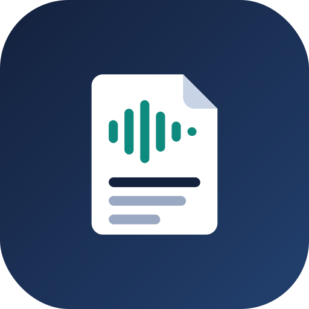

# Notule

Offline Afrikaans + English meeting recorder and minute-taker for Android.

- **Records** meetings in the background (screen off is fine), with pause and bookmarks.
- **Recognises voices** and labels them Person 1, Person 2… (rename them once, merge if needed).
- **Transcribes** Afrikaans, English and mixed SA speech with Fluister turbo (Whisper tuned for South African Afrikaans).
- **Cleans up** the text: punctuation, paragraphs per speaker, filler words removed, Dutch spellings fixed.
- **Finds details**: amounts, numbers, percentages, measurements, dates, times, names, places, addresses,
  phone numbers, e-mail addresses, colours, shapes and tasks — highlighted and tappable
  (add to calendar, open in Maps, call / WhatsApp, save contact, copy, VAT calculation…).
- **Summarises** the meeting on the phone with Gemma 4 E2B: overview, decisions, action items, key figures, follow-ups.
- **Keeps the audio** with the meeting and exports branded PDF minutes (logo, attendees, action table, signature lines), Word or text, with the audio attached.
- **Remembers voices**: name someone once and they're recognised in later meetings.
- **Your words**: a vocabulary list for names and terms, used for recognition and spelling.
- **Uncertain words** are underlined so you can check them against the audio.
- **Meeting templates**: general, board/committee, client consultation, site inspection, staff meeting.
- **Search** inside a meeting with matches on the audio timeline; **folders** per client or project; **import** audio from WhatsApp, voice recorders or calls.
- **Tasks** across all meetings, and send each person their tasks in one tap.
- **App lock** (fingerprint / PIN) and encrypted storage of transcripts, summaries and voices.
- **Afrikaans or English interface**, following the phone or chosen in Settings.

Everything runs on the phone. The only internet use is the one-time model download (~3.5 GB).

## Install

1. Download the latest `Notule-x.y.z.apk` from [Releases](../../releases) and install it (updates install over the old version).
2. Open **Models** → **Allow folder access** (models are kept in `Download/Notule/models`, so they survive updates and reinstalls) → **Download all** (Wi-Fi recommended).
3. Tap **Record**, or use the home-screen widget / quick-settings tile.

## How it works

| Step | Engine |
|---|---|
| Speech detection + voice recognition | sherpa-onnx: pyannote segmentation 3.0 + NVIDIA TitaNet large |
| Speech to text | whisper.cpp with Fluister turbo (q8_0) |
| Details | Rule-based extractor with fuzzy matching (Jaro-Winkler), Afrikaans/English number words, SA formats |
| Summary | LiteRT-LM with Gemma 4 E2B (falls back to key sentences when not installed) |

## Build

The `Build APK` workflow builds and publishes a signed APK on every push to `main`.
The `Prepare offline models` workflow converts Fluister to whisper.cpp format and publishes the model files
to the `models-v1` release.

To sign with your own permanent key, add repository secrets `KEYSTORE_B64` (base64 of a PKCS12 keystore with alias
`metings`) and `KEYSTORE_PASSWORD`.

## Credits

Fluister (DigiPhyte, MIT) · OpenAI Whisper (Apache-2.0) · whisper.cpp (MIT) · sherpa-onnx (Apache-2.0) ·
pyannote (MIT) · NVIDIA TitaNet (CC-BY-4.0) · Gemma 4 (Google, Apache-2.0) · LiteRT-LM (Apache-2.0).
